# Primer avance de la implementación

Reconocimiento de emociones en letras de canciones en español mediante aprendizaje multitarea.

Este primer avance deja listos los dos corpus del estudio y la **línea base de tarea única** (TU), que es la referencia contra la que se medirá el modelo multitarea en el siguiente avance. Todo se ejecutó en una computadora local con Anaconda y Jupyter.

## Contenido

1. [Entorno de trabajo](#1-entorno-de-trabajo)
2. [Recursos descargados y versiones](#2-recursos-descargados-y-versiones)
3. [Corpus MERGE Lyrics](#3-corpus-merge-lyrics)
4. [Traducción al español con NLLB-200](#4-traducción-al-español-con-nllb-200)
5. [Corpus BRIGHTER en español](#5-corpus-brighter-en-español)
6. [Modelo y configuración de entrenamiento](#6-modelo-y-configuración-de-entrenamiento)
7. [Resultados de la línea base de tarea única](#7-resultados-de-la-línea-base-de-tarea-única)
8. [Decisiones y ajustes durante el avance](#8-decisiones-y-ajustes-durante-el-avance)
9. [Siguiente avance](#9-siguiente-avance)

---

## 1. Entorno de trabajo

| Elemento | Detalle |
|---|---|
| Sistema operativo | Windows |
| Gestor de entornos | Anaconda (entorno `TESIS`), Jupyter Notebook |
| Python | 3.8.2 |
| PyTorch | 2.4.1 + CUDA 12.1 (`cu121`) |
| GPU | NVIDIA GeForce RTX 3050, 6 GB de memoria |
| Controlador NVIDIA | 560.94 (CUDA 12.6) |

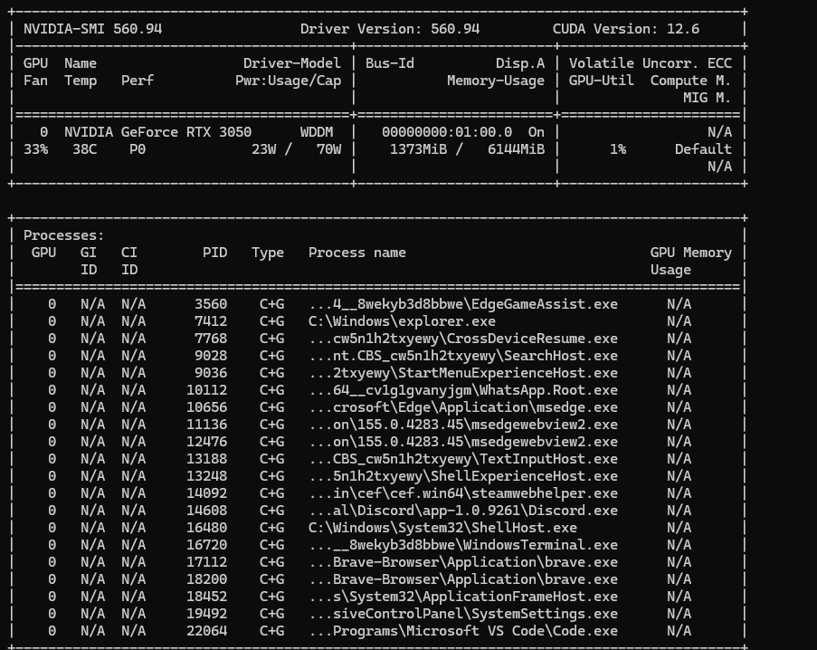

*Figura 1. La tarjeta gráfica disponible para el entrenamiento (RTX 3050, 6 GB).*

## 2. Recursos descargados y versiones

| Recurso | Uso | Origen | Versión / identificador |
|---|---|---|---|
| MERGE Lyrics Complete | Corpus principal: letras con valencia, activación y cuadrante | Zenodo, registro 13939205 | v1.1.0, MD5 `fae5bd689febeddc96595ac1843ffc77` (verificado) |
| BRIGHTER (español) | Corpus auxiliar: comentarios con 6 emociones | Hugging Face `brighter-dataset/BRIGHTER-emotion-categories`, configuración `esp` | Particiones oficiales train / dev / test |
| NLLB-200 distilled 600M | Traducción inglés → español | Hugging Face `facebook/nllb-200-distilled-600M` | `eng_Latn` → `spa_Latn` |
| mRoBERTa | Codificador del modelo | Hugging Face `BSC-LT/mRoBERTa` | RoBERTa base, 12 capas, 768 dimensiones, 512 tokens |

## 3. Corpus MERGE Lyrics

Se descargó el archivo comprimido de Zenodo, se comprobó su suma MD5 y se cargaron las tablas de valencia y activación, de cuadrantes y la partición oficial **70-15-15**.

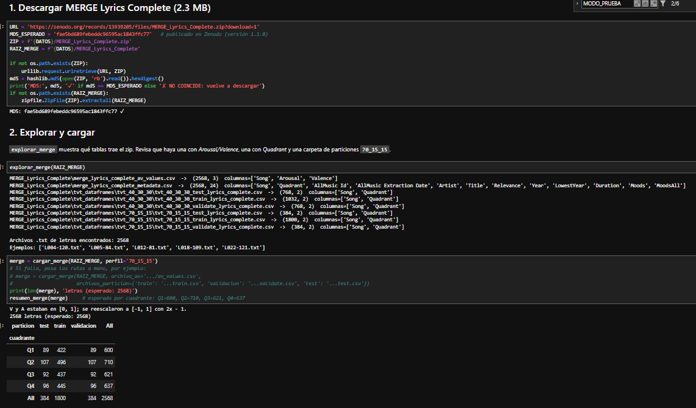

*Figura 2. Descarga verificada, tablas encontradas dentro del corpus y conteo por partición.*

| Partición | Q1 | Q2 | Q3 | Q4 | Total |
|---|---|---|---|---|---|
| train | 422 | 496 | 437 | 445 | 1800 |
| validación | 89 | 107 | 92 | 96 | 384 |
| test | 89 | 107 | 92 | 96 | 384 |
| **Total** | **600** | **710** | **621** | **637** | **2568** |

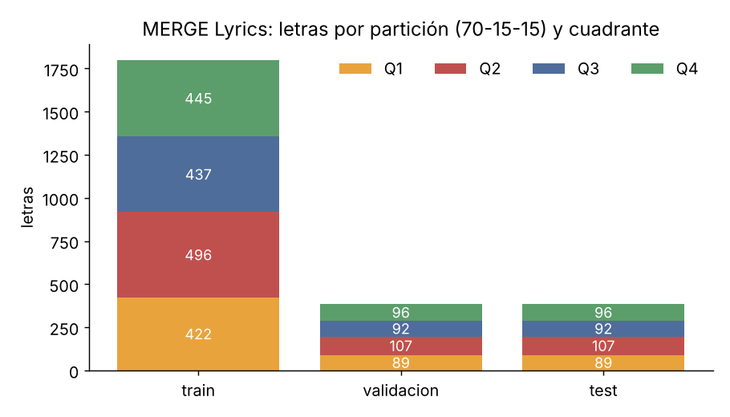

*Figura 3. Las tres particiones mantienen la misma proporción de cuadrantes.*

**Escala de valencia y activación.** MERGE publica ambas dimensiones en el rango [0, 1]. Para que el signo indique el cuadrante (Q1: V+ A+, Q2: V− A+, Q3: V− A−, Q4: V+ A−) se reescalaron a [−1, 1] con la transformación `2x − 1`.

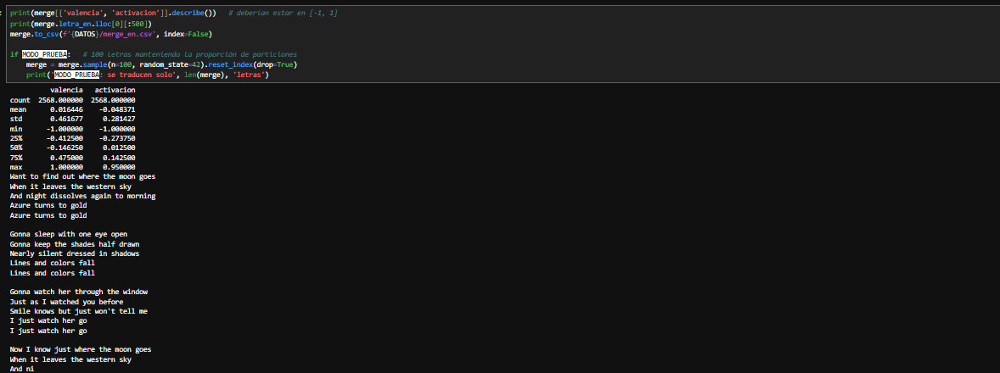

*Figura 4. Estadísticos tras el reescalado y medias por cuadrante, coherentes con la definición de cada cuadrante.*

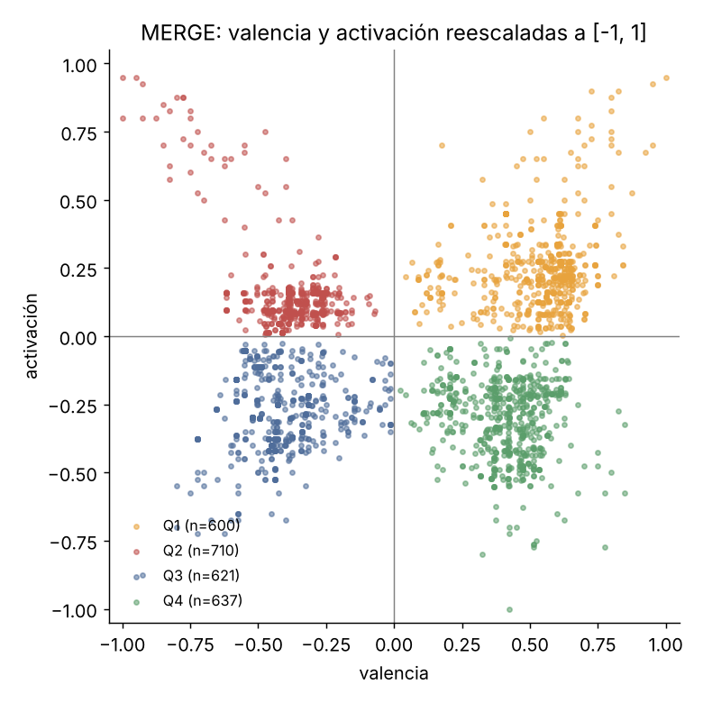

*Figura 5. Cada letra en el plano valencia-activación, coloreada por su cuadrante.*

## 4. Traducción al español con NLLB-200

Las letras se tradujeron **verso por verso** con NLLB-200 distilled 600M (búsqueda en haz de 4, decodificación determinista). Los versos repetidos, como los estribillos, se traducen una sola vez y se guardan en una caché, así que la traducción se puede retomar si se interrumpe.

| Dato | Valor |
|---|---|
| Versos únicos | 67 152 |
| Tiempo de la corrida completa en la RTX 3050 | 39 min 23 s (60 952 versos pendientes; el resto venía de la prueba) |
| Letras con alguna alerta automática | 80 de 2568 (3.1 %) |
| Alerta "verso sin traducir" | 54 letras |
| Alerta "repetición anómala" | 28 letras |

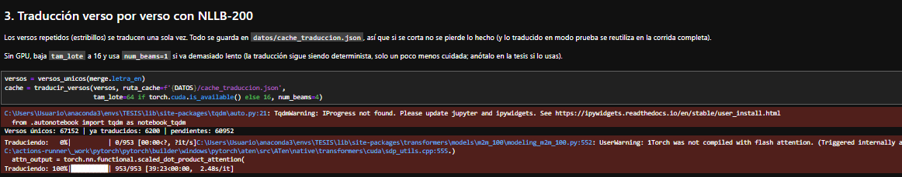

*Figura 6. Corrida completa de la traducción en GPU.*

Ejemplos tomados de la muestra de control de calidad:

| Inglés | Español (NLLB-200) |
|---|---|
| When I grow too old to dream / Your love will live in my heart | Cuando sea demasiado viejo para soñar / Tu amor vivirá en mi corazón |
| It's cold outside I'm just not feeling right | Hace frío afuera. No me siento bien. |
| Don't you go without me / Don't go and leave me here | No te vayas sin mí. / No me dejes aquí. |
| You spin my head right round, right round | Me giras la cabeza a la derecha, a la derecha *(traducción literal: se pierde la expresión)* |
| Rocket rocket rocket I said rocket rocket rocket | Cohetes de cohetes de cohetes dije cohetes de cohetes de cohetes de cohetes *(repetición anómala)* |

La traducción conserva bien el sentido en versos directos y falla sobre todo en expresiones coloquiales y versos repetitivos. Para medirlo se generó una **muestra estratificada de 100 letras** (25 por cuadrante), que se califica a mano en fidelidad semántica, conservación del tono y errores graves.

**Longitud en tokens.** Con el tokenizador de mRoBERTa, las letras en español tienen una media de 379 tokens y una mediana de 303 (máximo 1895). El **17.9 %** de las letras supera los 512 tokens y se trunca al entrar al modelo.

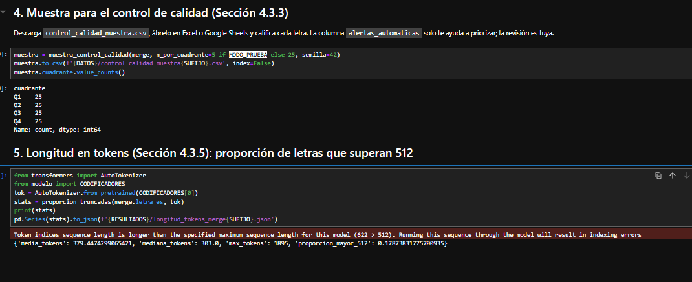

*Figura 7. Muestra para el control de calidad y estadísticas de longitud en tokens.*

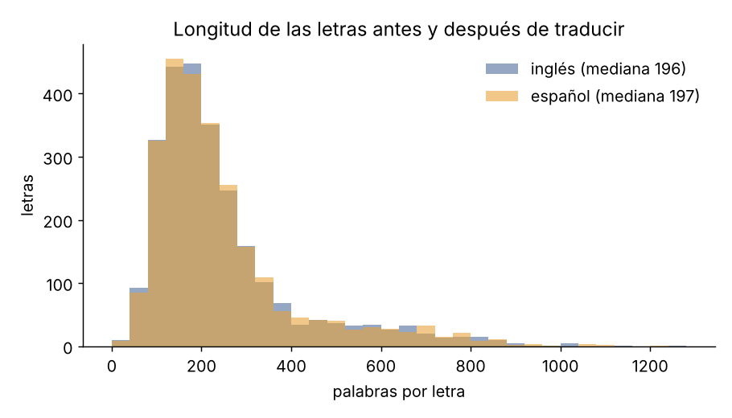

*Figura 8. La traducción mantiene la longitud de las letras (mediana de 196 palabras en inglés y 197 en español).*

## 5. Corpus BRIGHTER en español

Se cargó la configuración `esp` con sus particiones oficiales. La versión publicada en Hugging Face **repite cada texto de dev y test dos veces con un identificador distinto**. Los duplicados tienen las mismas etiquetas, así que se eliminaron por texto.

| Partición | Antes | Después | Ira | Asco | Miedo | Alegría | Tristeza | Sorpresa |
|---|---|---|---|---|---|---|---|---|
| train | 1996 | 1996 | 492 | 654 | 317 | 642 | 309 | 421 |
| validación | 368 | 184 | 34 | 65 | 32 | 54 | 31 | 40 |
| test | 3390 | 1695 | 403 | 556 | 200 | 541 | 246 | 394 |

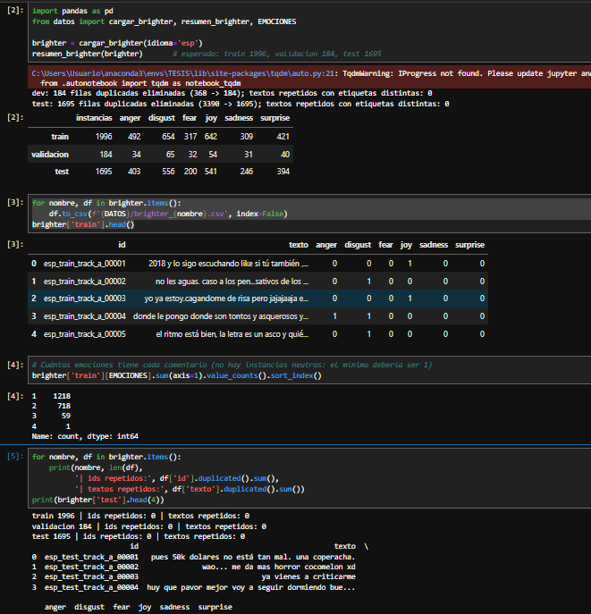

*Figura 9. Eliminación de duplicados y conteo final por emoción.*

Es un corpus **multietiqueta**: en train, 1218 comentarios tienen una emoción, 718 tienen dos, 59 tienen tres y 1 tiene cuatro. No hay comentarios sin emoción.

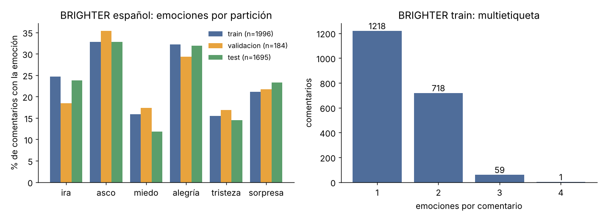

*Figura 10. Proporción de cada emoción por partición y número de emociones por comentario.*

## 6. Modelo y configuración de entrenamiento

**Arquitectura.** Codificador mRoBERTa compartido, seguido de una estrategia de agrupamiento, dropout de 0.1 y dos cabezales:

- **Regresión** (MERGE): 2 salidas, valencia y activación, con pérdida MSE.
- **Clasificación multietiqueta** (BRIGHTER): 6 salidas con pérdida BCE. Se usará en el modelo multitarea.

Se comparan tres estrategias de agrupamiento:

| Config. | Agrupamiento | Descripción |
|---|---|---|
| A | Token inicial | Vector del token `<s>` |
| B | Media | Promedio de los vectores de todos los tokens, sin contar el relleno |
| C | Atención | Promedio ponderado con pesos aprendidos (puntaje lineal y softmax) |

**Ajuste por memoria.** mRoBERTa tiene 282 M de parámetros, de los cuales unos 197 M son la tabla de embeddings de su vocabulario de 256 000 piezas. Para que el entrenamiento quepa en 6 GB se congeló **solo esa tabla**; las 12 capas del codificador y los cabezales se entrenan (85 M de parámetros entrenables). Además, cada lote de 16 se procesa en 4 trozos de 4 y se acumulan los gradientes, lo que da el mismo gradiente que el lote completo.

| Hiperparámetro | Valor |
|---|---|
| Optimizador | AdamW |
| Tasa de aprendizaje | 2 × 10⁻⁵ |
| Decaimiento de pesos | 0.01 |
| Calentamiento | 10 % de los pasos, luego decaimiento lineal |
| Tamaño de lote | 16 (4 micro-lotes de 4) |
| Épocas | 4 |
| Longitud máxima | 512 tokens |
| Dropout | 0.1 |
| Proporción de tarea principal `p` | 1.0 (tarea única) |
| Precisión | Mixta (fp16) con recorte de gradiente en 1.0 |
| Selección del modelo | Época con menor MSE de validación (promedio de V y A) |
| Semillas | 42, 43 y 44 |

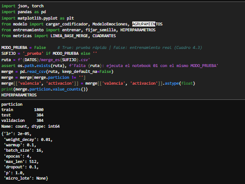

*Figura 11. Datos de entrada y configuración de hiperparámetros en el notebook.*

Cada época tarda unos **84 segundos** en la RTX 3050, así que una corrida completa de 4 épocas toma unos 6 minutos. Se entrenaron **9 modelos** (3 agrupamientos × 3 semillas).

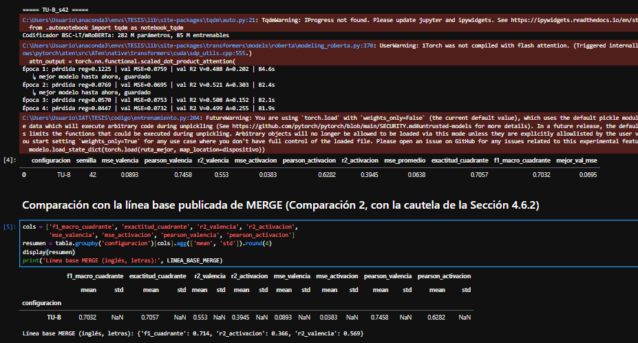

*Figura 12. Registro de una corrida (TU-B, semilla 42): parámetros entrenables, pérdida y métricas de validación por época.*

## 7. Resultados de la línea base de tarea única

El cuadrante se deriva del signo de la valencia y la activación predichas. Todas las métricas son sobre la partición **test de MERGE** (384 letras), con media ± desviación estándar de las 3 semillas.

| Configuración | F1 macro (cuadrante) | Exactitud (cuadrante) | R² valencia | R² activación | Pearson V | Pearson A |
|---|---|---|---|---|---|---|
| TU-A (token inicial) | 0.676 ± 0.023 | 0.676 ± 0.024 | 0.551 ± 0.008 | 0.358 ± 0.024 | 0.749 | 0.616 |
| **TU-B (media)** | **0.701 ± 0.002** | **0.701 ± 0.005** | 0.545 ± 0.009 | 0.397 ± 0.008 | 0.742 | 0.634 |
| TU-C (atención) | 0.696 ± 0.013 | 0.698 ± 0.016 | 0.550 ± 0.016 | **0.398 ± 0.018** | 0.746 | 0.638 |
| MERGE publicado (inglés) | 0.714 | — | 0.569 | 0.366 | — | — |

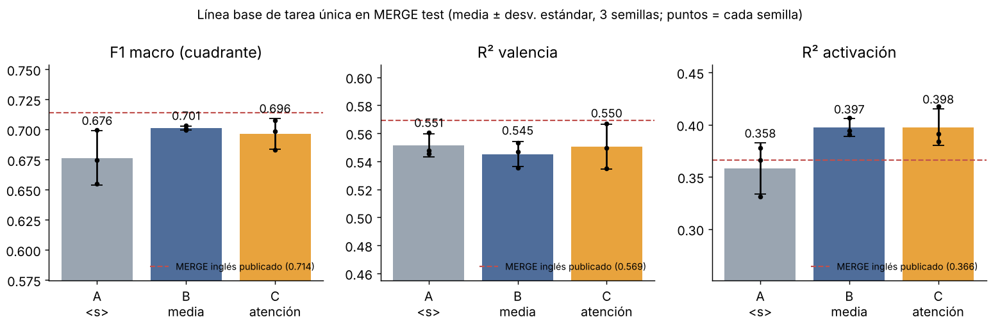

*Figura 13. Comparación de los tres agrupamientos frente al resultado publicado por MERGE sobre letras en inglés.*

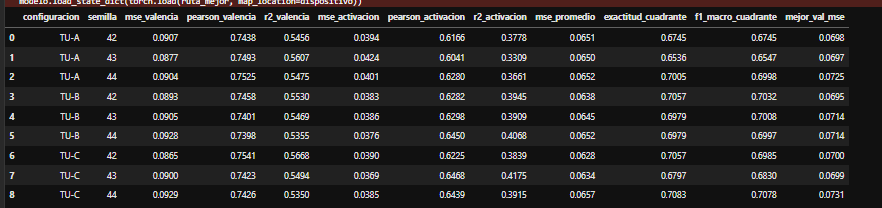

*Figura 14. Métricas de cada una de las 9 corridas.*

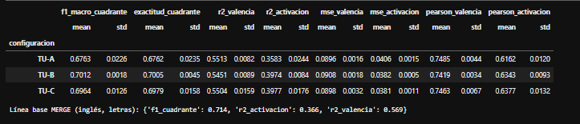

*Figura 15. Resumen por configuración (media y desviación estándar).*

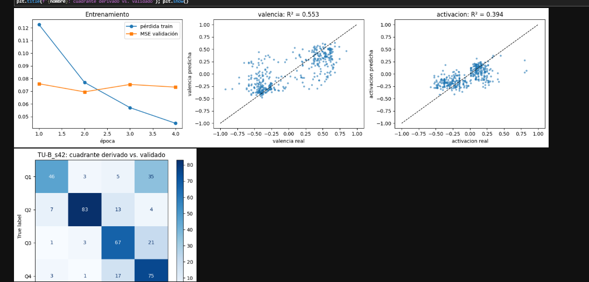

*Figura 16. TU-B, semilla 42: curva de entrenamiento, valores predichos frente a reales y matriz de confusión de cuadrantes.*

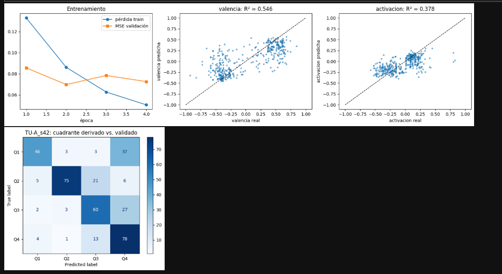

*Figura 17. TU-A, semilla 42, para comparar con la figura anterior.*

### Lectura de los resultados

- **Los agrupamientos B y C superan al A**, sobre todo en activación (R² de 0.40 frente a 0.36) y en F1 de cuadrante (0.70 frente a 0.68). Entre B y C no hay una diferencia clara: la distancia entre ellos es menor que la variación entre semillas. **B es el más estable** (desviación de 0.002 en F1).
- **Frente al resultado publicado en inglés**, las letras traducidas al español alcanzan un R² de activación mayor (0.40 frente a 0.37) y quedan entre 1 y 2 puntos por debajo en valencia y F1. La traducción automática conserva buena parte de la información emocional. La comparación es orientativa, porque el modelo y el idioma son distintos.
- **La valencia se predice mejor que la activación** en todas las configuraciones.
- **El error más frecuente es confundir Q1 con Q4**: el modelo subestima la activación de canciones alegres y enérgicas y las ubica como tranquilas.
- La mejor época suele ser la **segunda**; después, la pérdida de entrenamiento sigue bajando pero el MSE de validación sube, lo que indica que el modelo empieza a sobreajustar.

## 8. Decisiones y ajustes durante el avance

| Situación | Decisión |
|---|---|
| El modelo previsto, `PlanTL-GOB-ES/roberta-base-bne` (MarIA), fue retirado de Hugging Face | Se usó `BSC-LT/mRoBERTa`, del mismo centro (BSC), con la misma arquitectura RoBERTa base y soporte para español |
| mRoBERTa no cabía completo en una GPU de 6 GB | Se congeló solo la tabla de embeddings de palabras y se usaron micro-lotes de 4 con acumulación de gradiente |
| MERGE publica valencia y activación en [0, 1] | Se reescalaron a [−1, 1] con `2x − 1` para derivar el cuadrante por signo |
| BRIGHTER en Hugging Face duplica dev y test | Se eliminaron los duplicados por texto (184 y 1695 instancias) |
| Python 3.8.2 en el entorno local | Se instaló PyTorch 2.4.1 con CUDA 12.1, compatible con esa versión de Python |

## 9. Siguiente avance

- Entrenar el **modelo multitarea** (MT-A, MT-B y MT-C) con MERGE como tarea principal y BRIGHTER como tarea auxiliar (`p = 0.7`), con las mismas 3 semillas.
- Comparar el multitarea contra esta línea base con bootstrap pareado.
- Completar la calificación manual de la muestra de traducción.
- Hacer el análisis cualitativo de los errores, en particular la confusión entre Q1 y Q4.

---

### Archivos de este avance

```
primer-avance/
├── README.md
├── imagenes/        capturas de la ejecución (c*) y gráficos generados (g*)
└── resultados/
    ├── tabla_tarea_unica.csv      métricas de las 9 corridas
    └── longitud_tokens_merge.json estadísticas de longitud en tokens
```
